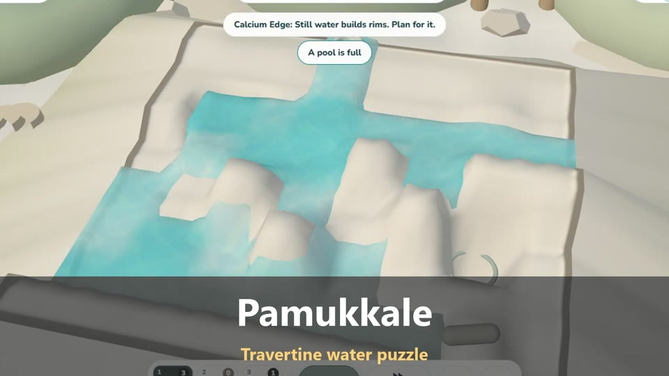
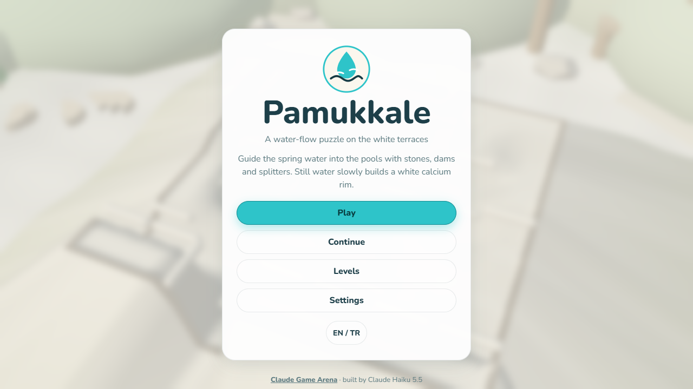
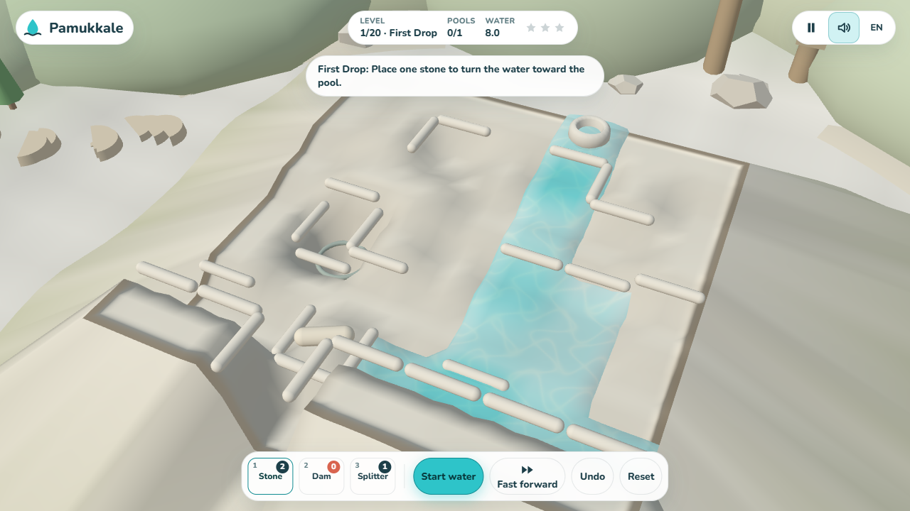
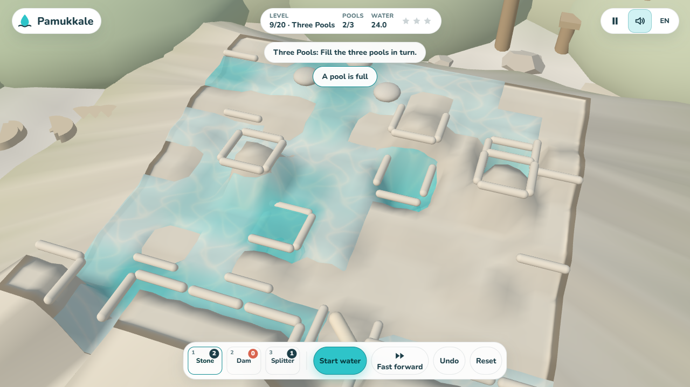
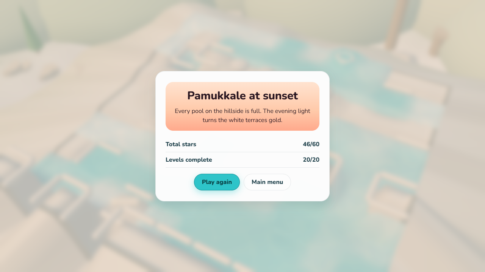
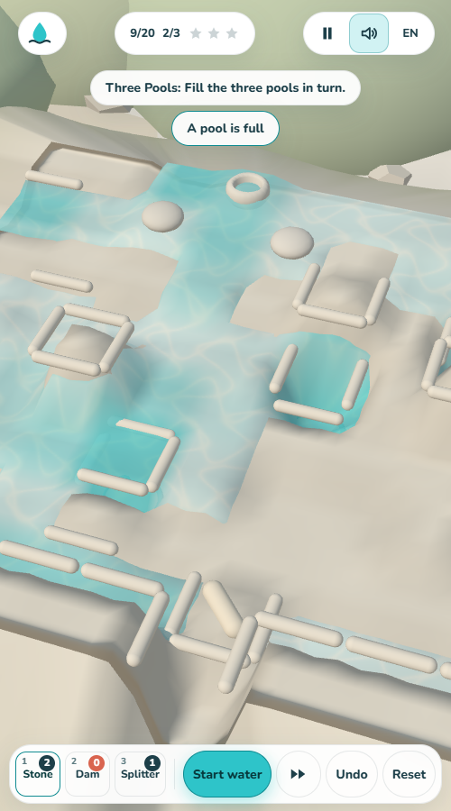
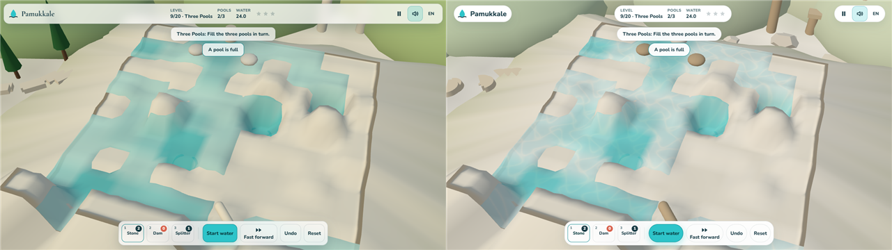

<p align="center">
  <a href="https://furkiozknn.github.io/pamukkale/">
    
  </a>
</p>

<p align="center">
  <a href="https://furkiozknn.github.io/pamukkale/"></a>
</p>

<p align="center">
  
  
  <a href="LICENSE"></a>
  
</p>

<!-- portals:start -->
<p align="center">
  Also on: <a href="https://furkiozknn.itch.io/pamukkale"><strong>itch.io</strong></a>
</p>
<!-- portals:end -->

<p align="center">
  <strong>A calm 3D water-flow puzzle on the white travertine terraces of Pamukkale: guide warm spring water down the hillside into the target pools with stones, dams and splitters, while still water slowly builds new white calcium rims and changes the terraces as you play.</strong>
</p>

<!-- gameplay gif -->

## Features

- **Living terraces & procedural puzzle:** Water that stands still builds calcium: dry cells beside a standing pool rise to the water line, so the board dynamically evolves and changes flow paths while water runs.
- **23 levels across 5 distinct areas:** Progress through Lower Pools, Middle Shelves, Ancient Pool, Sunset, and Calcium Time, earning up to 3 stars per level (all pools full, no water spilled, and par tool saving).
- **Calcium Time: sluice gates:** The last three levels add a fixed gate the player opens or closes while the water runs. Timing matters: let a pool fill, then redirect; or shut the gate so still water raises a leaking pool's rim, then open it again. `tools/solve-levels.mjs` checks that no fixed gate setting solves these levels and prints a timed solution with its tick window.
- **Tactical 3-tool water routing:** Place stones (raises a cell by 1 step so water turns around it), dams (raises by 2 steps to hold water back), and splitters (divides flow among lower neighbours).
- **Verified level design & bot replay:** Layouts originate from seeded random hillsides where empty boards fail; `?auto` bot replays stored solutions at 3x speed, verifying **20/20 levels and 46/60 stars** with 0 JavaScript errors (with and without `?noassets`); with the gate levels: 23/23 levels and 52/69 stars, 0 errors (headless Chromium, 2026-11-09, without `?noassets`).
- **Lean single-file 3D performance:** A single `index.html` running Three.js r170 delivering 21–22 draw calls and 34k triangles in play on Intel UHD 620, complete with procedural geometry and Web Audio synthesis (saz loop, flute, trickling water, splashes, and birdsong).

## How to play

> [!TIP]
> **Goal:** Guide warm spring water down the terraces into every target pool. Block spill paths early: spilled water costs the "no water spilled" star, and every tool kept in reserve counts towards the tool-saving star.

1. **Place your tools:** Select a tool (`1` stone, `2` dam, `3` splitter) and click or tap cells on the hillside grid to place them.
2. **Start the flow (`Space`):** Release warm water from the steaming spring at the top of the terraces and watch how it channels into target pools.
3. **Fill every pool mark:** Fill each target pool until its ring turns turquoise. Avoid letting water escape off the bottom edge.

<details>
<summary><b>Rules and star objectives</b></summary>

- **Target pools:** Fill every target pool to its mark. The ring inside each pool indicates the required level and turns turquoise when full.
- **Three stars per level:**
  - *All pools full:* Every target pool filled to its mark.
  - *No water spilled:* Prevent water from flowing off the bottom edge of the board.
  - *Tool saving:* Complete the level using at most the par number of tools.
- **Living calcium rims:** Water that stands still builds calcium deposits. Dry cells beside a standing pool rise to the water line, altering the terrain in real time.
- **Sluice gates (levels 21-23):** A closed gate stands 3 steps above its cell; an open one lets water through. Click it any time, also while the water runs. Gates cost no tools and gather no calcium.
- **Tool roles:**
  - *Stone:* Raises a cell by 1 step to turn water around it.
  - *Dam:* Raises a cell by 2 steps to hold water back.
  - *Splitter:* Divides the flow between every lower neighbour.

</details>

### Controls

| Action | Keys / mouse / touch |
|---|---|
| Place selected tool | Click or tap a cell |
| Remove a tool | Right-click, or long-press on touch |
| Select tool | `1` stone, `2` dam, `3` splitter, or tap the tray |
| Open / close a sluice gate | Click or tap the gate, or `G` (the gate under the cursor, or the only gate) |
| Start / stop water | `Space` (or the water button) |
| Fast forward | `F` |
| Undo last tool change | `Z` |
| Reset level | `R` |
| Pause / resume | `P` or `Esc` |
| Music / effects / language | `M` / `X` / `L` |
| Orbit / zoom | Drag (mouse or one finger) / mouse wheel or pinch |

- **Language:** Turkish or English (`L` or the **EN** toggle switches; follows browser by default).
- **Persistence:** Progress is saved in `localStorage` under `arena.pamukkale.save`, settings under `arena.pamukkale.settings`, and best results under `arena.pamukkale.best`.

<details>
<summary><b>URL flags for testing</b></summary>

| Flag | Effect |
|---|---|
| `?auto` | The bot plays all 23 levels, replaying each stored solution (and gate toggles at their verified ticks) at 3x speed |
| `?debug` | FPS, draw calls, triangles, and JavaScript errors on screen |
| `?sim=N` | Start the first level with N seconds of water already fast-forwarded |
| `?low` | Shadows off, fewer particles, pixel ratio 1 |
| `?lang=en` | English start language |
| `?noassets` | Accepted for the arena convention; the game has no asset files anyway |

`window.pamukkaleSim(seconds)` fast-forwards the simulation without rendering and returns the live state.

</details>

## Screenshots

<table>
  <tr>
    <td width="33%"><br><sub>Title screen</sub></td>
    <td width="33%"><br><sub>Level 1</sub></td>
    <td width="33%"><br><sub>Level 9, three pools</sub></td>
  </tr>
  <tr>
    <td><br><sub>Ending after the <code>?auto</code> run: 20/20 levels, 46/60 stars</sub></td>
    <td><br><sub>On a phone</sub></td>
    <td></td>
  </tr>
</table>

## Redesign & Performance

**Art direction:** Bright pastel travertine on a sage meadow: turquoise water with shore foam and caustic light, peach sunset sky, airy white cards with turquoise accents. Palette: travertine `#F5F3EE`, turquoise `#2EC4C9`, sunset peach `#FFC9A9`, ruin stone `#CDB89A`, sky `#BFE6FF`.

**Visual updates (simulation, levels, controls, bot, and saves are untouched):**
- **Terraces:** Travertine step edges that catch the light (the steepest shelf edges brighten towards `#FBF8F2`), slope shading, and stepped travertine ledges down the valley sides.
- **Scene:** Pastel meadow, shrubs, boulders, a pale distant range inside the fog, lathe-turned spring bowl, rounded theatre benches, and ruin columns.
- **Water and FX:** Shore foam, scrolling caustic texture, tool placement sparkle, and slowly drifting clouds.
- **UI:** White cards, pill buttons, floating HUD pills, and a layout that works on phones and short landscape screens.
- **Language:** The default follows the browser (Turkish or English); a saved setting still wins.

**Measured on an Intel UHD 620 (headless Chrome, 1280x720):**
- Draw calls: 17 &rarr; 21 (level 9 in play)
- Triangles: 26k &rarr; 34k
- Bot run: `?auto` finishes 20/20 levels and 46/60 stars with 0 JS errors (with and without `?noassets`); this was before the 3 gate levels, the game now has 23 levels (23/23 and 52/69 stars, see Features)
- Note: Frame rate is not claimed; headless rAF is not a GPU budget.



## Running locally

Serve the folder over HTTP (ES modules do not load from `file://`):

```bash
python -m http.server 8000
```

Then open <http://localhost:8000/>. Check every level offline with `node tools/solve-levels.mjs`: it prints a solution per level, or FAILED; for gate levels also the toggles `[x, y, tick]`, each toggle's working tick window, and `needsTiming`. `node tools/smoke.mjs chromium firefox webkit` (needs `playwright`) opens the game in real browsers, fails on page errors or a stale SRI hash in the import map, and runs on every pull request (`.github/workflows/smoke.yml`).

## Made with Claude Code

Built by **Claude Haiku 5.5** with Claude Code from one prompt: [prompts/pamukkale.md](prompts/pamukkale.md). Everything is generated in code, so there are no asset files and no credits to list; Three.js is loaded from a CDN under its MIT licence.

<details>
<summary><b>Technical notes</b></summary>

- **Simulation:** The water is a small grid automaton in plain JavaScript between the `SIM-BEGIN` and `SIM-END` markers in `index.html`; `tools/solve-levels.mjs` runs the same code.
- **3D:** Terrain, water, and tools are procedural geometry with vertex colours, with instanced meshes for repeated objects; 21–22 draw calls measured in play on the redesign branch. The headless frame rate is a rAF reading, not a measured GPU budget, so no fps figure is claimed.
- **Known limits:** The terraces are an approximate, plateau-style hillside and the sloped apron at the edge is a simplified form; level 16 uses a looser difficulty band than its neighbours.

</details>

### Claude Game Arena

Pamukkale is part of the **Claude Game Arena** series, where each game is built by a Claude model from one prompt.

[Hisar](https://furkiozknn.github.io/kale-savunmasi/) · [Çay Ocağı](https://furkiozknn.github.io/cay-ocagi/) · [Çini Ustası](https://furkiozknn.github.io/cini-ustasi/) · [Martı](https://furkiozknn.github.io/marti/) · [Kervan](https://furkiozknn.github.io/kervan/) · [Dolmuş](https://furkiozknn.github.io/dolmus/) · [Peri Golf](https://furkiozknn.github.io/peri-golf/) · [Mehter](https://furkiozknn.github.io/mehter/) · [Boğaz Vapuru](https://furkiozknn.github.io/bogaz-vapuru/) · [Simit Fırını](https://furkiozknn.github.io/simit-firini/) · [Karagöz](https://furkiozknn.github.io/karagoz/) · [Lale Bahçesi](https://furkiozknn.github.io/lale-bahcesi/)

**Round 5:** [Kapadokya Balonu](https://furkiozknn.github.io/kapadokya-balonu/) · [Ebru](https://furkiozknn.github.io/ebru/) · [Kırkpınar](https://furkiozknn.github.io/kirkpinar/) · [Çarşı Kaçışı](https://furkiozknn.github.io/carsi-kacisi/)

**Round 6:** [Topkapı Gecesi](https://furkiozknn.github.io/topkapi-gecesi/) · [Hamsi](https://furkiozknn.github.io/hamsi/) · **Pamukkale** · [Mimar Sinan](https://furkiozknn.github.io/mimar-sinan/)

## License

MIT, see [LICENSE](LICENSE).

Like the game? You can support new rounds on [Buy Me a Coffee](https://buymeacoffee.com/furkiozkann). The game stays free.
