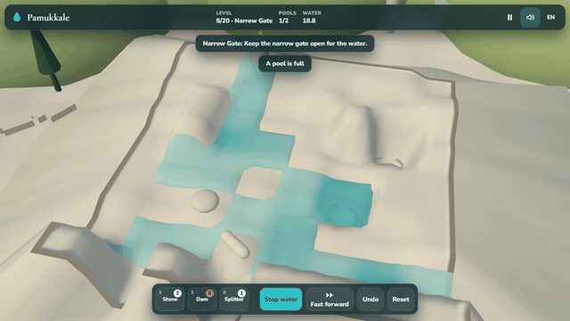
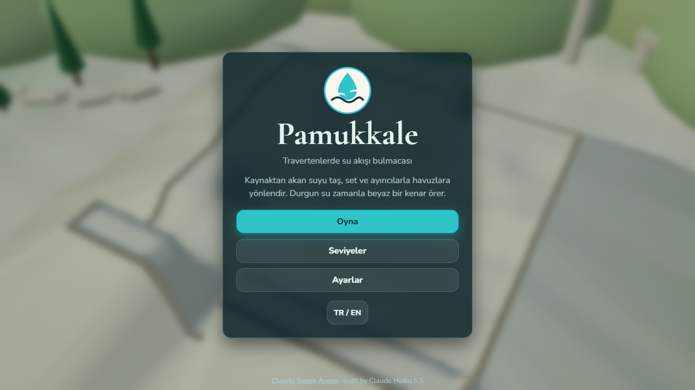
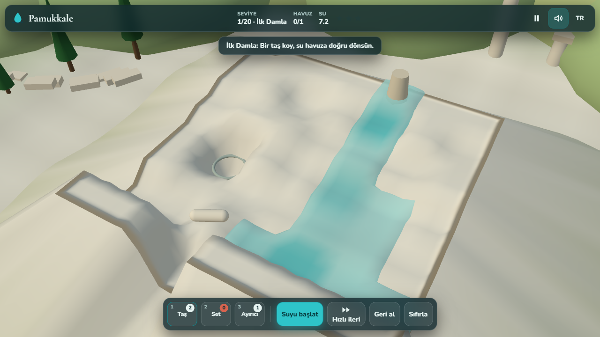
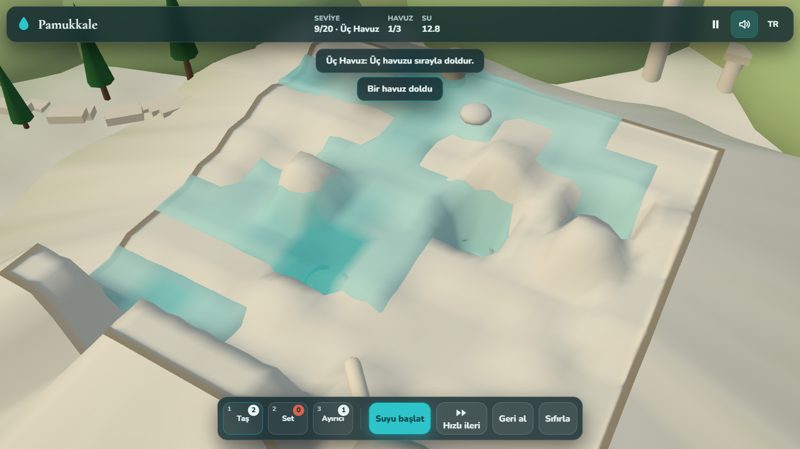
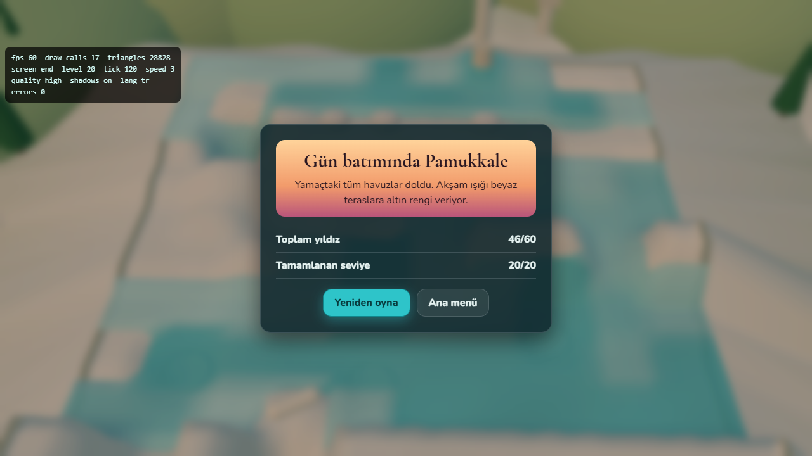
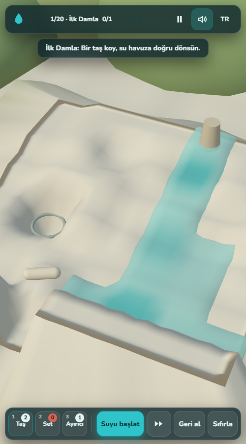

<p align="center">
  <a href="https://furkiozknn.github.io/pamukkale/"></a>
</p>

<p align="center">
  <a href="https://furkiozknn.github.io/pamukkale/"></a>
  
  
  <a href="LICENSE"></a>
  
</p>

<p align="center"><b>A calm 3D water-flow puzzle on the white travertine terraces of Pamukkale: guide warm spring water down the hillside into the target pools with stones, dams and splitters, while still water slowly builds new white calcium rims and changes the terraces as you play.</b></p>

<p align="center">
  
</p>

<p align="center"><b>Play online: <a href="https://furkiozknn.github.io/pamukkale/">https://furkiozknn.github.io/pamukkale/</a></b> (desktop and phone, no install)</p>

<!-- portals:start -->
<p align="center">Also on: <a href="https://furkiozknn.itch.io/pamukkale">itch.io</a></p>
<!-- portals:end -->

## Highlights

- **Three tools, limited.** A stone raises a cell by one step so the water turns around it, a dam raises it by two
  and holds water back, and a splitter divides the flow between every lower neighbour.
- **Living terraces.** Water that stands still for a while builds calcium: dry cells beside a standing pool rise to
  the water line, so the board changes while the water runs.
- **20 levels in 4 areas.** Lower Pools, Middle Shelves, Ancient Pool and Sunset. Three stars per level: all pools
  full, no water spilled, and tool saving (at most the par number of tools).
- **Every level checked.** Layouts come from seeded random hillsides and were kept only if the empty board fails and
  a short solution fills every pool; `tools/solve-levels.mjs` re-checks each stored solution with the same simulation
  code.
- **Played by a bot.** `?auto` replays each level's stored solution through the same placement function a click uses.
  Measured: **20/20 levels, 46/60 stars**, 14-18 draw calls.
- **One file, made in code.** One `index.html` with Three.js r170 from a CDN; terrain, water and tools are procedural
  geometry, and a saz-like plucked loop, a flute line, trickling water, splashes and birdsong are synthesised with
  Web Audio.

## How to play

> [!TIP]
> Watch where the water leaves the board and block that path first: spilled water costs the "no water spilled" star,
> and every tool you keep in the tray counts towards the tool-saving star.

Warm water comes out of the spring at the top of the terraces. Place your tools on the grid, then start the water.
Fill every target pool to its mark: the ring in each pool shows the mark and turns turquoise when the pool is full.
Water that runs off the bottom edge is spilled and wasted.

### Controls

| Action | Keys / mouse / touch |
|---|---|
| Place the selected tool | click or tap a cell |
| Remove a tool | right-click, or long-press on touch |
| Select tool | `1` stone, `2` dam, `3` splitter, or tap the tray |
| Start / stop water | `Space` (or the water button) |
| Fast forward | `F` |
| Undo last tool change | `Z` |
| Reset level | `R` |
| Pause / resume | `P` or `Esc` |
| Music / effects / language | `M` / `X` / `L` |
| Orbit / zoom | drag (mouse or one finger) / mouse wheel or pinch |

Turkish is the default language (`L` or the **EN** toggle switches). Progress is saved in `localStorage` under
`arena.pamukkale.save`, settings under `arena.pamukkale.settings` and the best result under `arena.pamukkale.best`.

<details>
<summary><b>URL flags for testing</b></summary>

| Flag | Effect |
|---|---|
| `?auto` | the bot plays all 20 levels, replaying each stored solution at 3x speed |
| `?debug` | fps, draw calls, triangles and any JavaScript errors on screen |
| `?sim=N` | start the first level with N seconds of water already fast-forwarded |
| `?low` | shadows off, fewer particles, pixel ratio 1 |
| `?lang=en` | English |
| `?noassets` | accepted; the game has no asset files, so nothing changes |

`window.pamukkaleSim(seconds)` fast-forwards the simulation without rendering and returns the live state.

</details>

## Screenshots

<table>
  <tr>
    <td width="33%"><br><sub>Title screen</sub></td>
    <td width="33%"><br><sub>Level 1</sub></td>
    <td width="33%"><br><sub>Level 9, three pools</sub></td>
  </tr>
  <tr>
    <td><br><sub>Ending after the <code>?auto</code> run (with <code>?debug</code>)</sub></td>
    <td><br><sub>On a phone</sub></td>
    <td></td>
  </tr>
</table>

## Running locally

Serve the folder over HTTP, for example:

```
python -m http.server 8000
```

then open <http://localhost:8000/>. Check every level offline with `node tools/solve-levels.mjs`: it prints a
solution per level, or FAILED.

## How it was made

Built by **Claude Haiku 5.5** with Claude Code from one prompt: [prompts/pamukkale.md](prompts/pamukkale.md).
Everything is generated in code, so there are no asset files and no credits to list.

<details>
<summary><b>Technical notes</b></summary>

- **Simulation:** the water is a small grid automaton in plain JavaScript between the `SIM-BEGIN` and `SIM-END`
  markers in `index.html`; `tools/solve-levels.mjs` runs the same code.
- **3D:** terrain, water and tools are procedural geometry with vertex colours, with instanced meshes for repeated
  objects; 14-18 draw calls measured. The headless frame rate is a rAF reading, not a measured GPU budget, so no fps
  figure is claimed.
- **Known limits:** the terraces are an approximate, plateau-style hillside and the sloped apron at the edge is a
  simplified form; level 16 uses a looser difficulty band than its neighbours.

</details>

Pamukkale is part of the **Claude Game Arena** series, where each game is built by a Claude model from one prompt. The
other games: [Hisar](https://furkiozknn.github.io/kale-savunmasi/) ·
[Çay Ocağı](https://furkiozknn.github.io/cay-ocagi/) · [Çini Ustası](https://furkiozknn.github.io/cini-ustasi/) ·
[Martı](https://furkiozknn.github.io/marti/) · [Kervan](https://furkiozknn.github.io/kervan/) ·
[Dolmuş](https://furkiozknn.github.io/dolmus/) · [Peri Golf](https://furkiozknn.github.io/peri-golf/) ·
[Mehter](https://furkiozknn.github.io/mehter/) · [Boğaz Vapuru](https://furkiozknn.github.io/bogaz-vapuru/) ·
[Simit Fırını](https://furkiozknn.github.io/simit-firini/) · [Karagöz](https://furkiozknn.github.io/karagoz/) ·
[Lale Bahçesi](https://furkiozknn.github.io/lale-bahcesi/)

**Round 5:** [Kapadokya Balonu](https://furkiozknn.github.io/kapadokya-balonu/) ·
[Ebru](https://furkiozknn.github.io/ebru/) · [Kırkpınar](https://furkiozknn.github.io/kirkpinar/) ·
[Çarşı Kaçışı](https://furkiozknn.github.io/carsi-kacisi/)

**Round 6:** [Topkapı Gecesi](https://furkiozknn.github.io/topkapi-gecesi/) · [Hamsi](https://furkiozknn.github.io/hamsi/) ·
**Pamukkale** · [Mimar Sinan](https://furkiozknn.github.io/mimar-sinan/)

## Türkçe

**Pamukkale**, beyaz travertenlerde geçen sakin bir 3D su akışı bulmacası. Kaynaktan çıkan ılık suyu taş, set ve
ayırıcılarla yamaçtan aşağı, hedef havuzlara yönlendirirsin. Durgun su zamanla beyaz kireç kenarlar örer, teraslar
oynarken değişir. 4 bölgede 20 seviye, seviye başına 3 yıldız. Kurulum yok; masaüstünde ve telefonda tarayıcıda
oynanır. Claude Haiku 5.5 tarafından Claude Code ile tek bir prompt'tan yapıldı.

**Oyna:** https://furkiozknn.github.io/pamukkale/

## License

MIT, see [LICENSE](LICENSE).

Like the game? You can support new rounds on [Buy Me a Coffee](https://buymeacoffee.com/furkiozkann). The game stays free.
